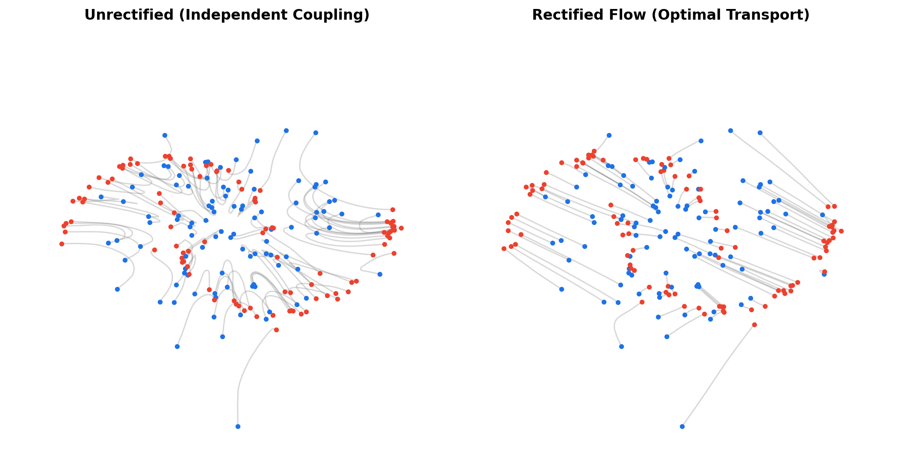
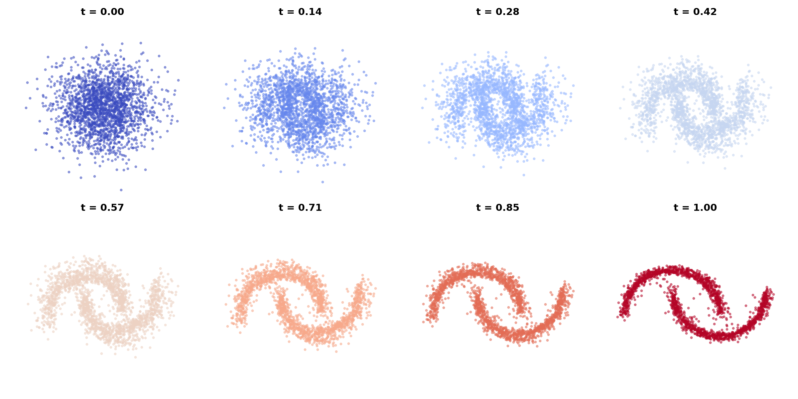
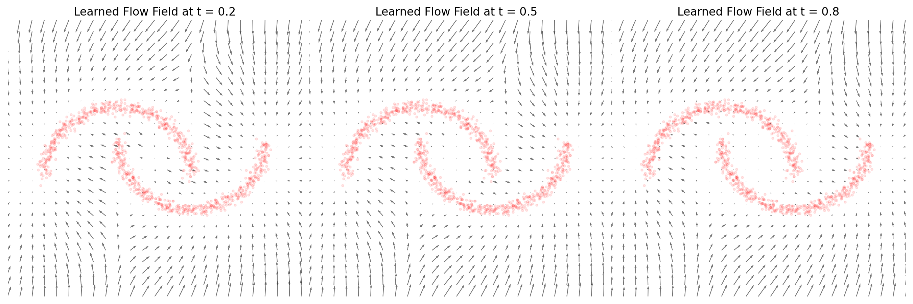
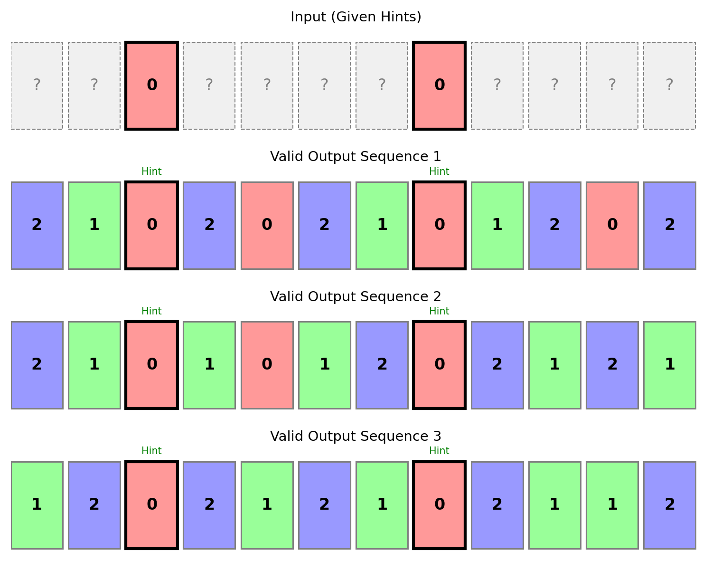

<div class="img-block" style="width: 600px;">
    
</div>
<center>Flow Matching: Transporting noise to data.</center>


<!--
### Contents
* TOC
{:toc}
-->

<em style="float:right">First draft: 2026-03-15</em><br>

### Introduction

For the last few years, Diffusion models have dominated the generative AI landscape (DALL-E, Stable Diffusion, Sora). But under the hood, diffusion involves some rather messy math: stochastic differential equations, complex variance schedules, and navigating curved paths through latent space.

Recently, a new paradigm has emerged that achieves the exact same goal—turning noise into data—but does so with remarkably simpler math and more efficient paths. It's called **Flow Matching** (often formulated as **Rectified Flow**).

The basic idea of Flow Matching is to learn a **vector field** that points from a simple distribution (like a standard Gaussian) to a complex distribution (like images, or robot action trajectories). If you drop a particle in the noise distribution, the vector field acts like a river current, flowing the particle exactly to a valid data point. 

<p class="vspace"></p>

### The Goal: Continuous Normalizing Flows (CNFs)

Imagine we have two worlds:
1. <strong style="color: #1E72E7">The Noise World</strong> ($t=0$): A simple Gaussian distribution $\mathcal{N}(0, I)$. We can easily sample points from here. Let's call a point here <strong style="color: #1E72E7">$x_0$</strong>.
2. <strong style="color: #ED412D">The Data World</strong> ($t=1$): Our complex dataset (e.g., images of cats, valid graph colorings). Let's call a point here <strong style="color: #ED412D">$x_1$</strong>.

We want to define a path $x_t$ over time $t \in[0, 1]$ that smoothly transforms <strong style="color: #1E72E7">$x_0$</strong> into <strong style="color: #ED412D">$x_1$</strong>. 

To do this, we need an **Ordinary Differential Equation (ODE)**. We want to find a time-dependent vector field $v(x, t)$ such that if we follow it, we end up at the data. The ODE is simply:

$$
\frac{d}{dt}x_t = v(x_t, t)
$$

If we knew the perfect $v(x, t)$, generation would be trivial: sample <strong style="color: #1E72E7">$x_0$</strong>, and use an integration approximation method to integrate the velocity over time, typically called ODE solver, (like Euler's method) to integrate forward to $t=1$. But the true vector field mapping the entire noise distribution to the entire data distribution is incredibly complex and intractable.

<!--[INSERT PLOT 1: 2D Particle Evolution (t=0, t=0.5, t=1.0) - Show the noise forming into moons/gaussians] -->
<div class="img-block" style="width: 800px;">
    
</div>
<center>Fig 1: Particles flowing from a Gaussian prior at $t=0$ to a complex target distribution at $t=1$.</center>
<p class="vspace"></p>


### Conditional Flow Matching

How do we learn this intractable vector field? This is where **Conditional Flow Matching (CFM)** comes in.

Instead of trying to figure out how the *entire* noise distribution maps to the *entire* data distribution, what if we just focus on **one specific data point** <strong style="color: #ED412D">$x_1$</strong> at a time?

If we condition on a specific target <strong style="color: #ED412D">$x_1$</strong>, we can explicitly define a simple, known vector field $u_t(x \mid x_1)$ that points exactly to it. The magic of CFM is a mathematical proof showing that if a neural network learns to match these *conditional* vector fields on average, it will naturally learn the correct *unconditional* global vector field!

Our objective function becomes a simple Mean Squared Error (MSE):

$$
\mathcal{L}_{CFM} = \mathbb{E}_{t, x_0, x_1} \left[ \left\| v_\theta(x_t, t) - u_t(x_t \mid x_1) \right\|^2 \right]
$$

Where:
- $v_\theta(x_t, t)$ is our Neural Network predicting the velocity.
- $u_t(x_t \mid x_1)$ is the known target velocity.

But what exactly is $x_t$ and the target velocity $u_t$? That depends on how we draw the paths.

### Rectified Flow: Keeping it Straight

In diffusion models, paths from noise to data look like random, squiggly Brownian motion. In Flow Matching, we have the freedom to choose any path we want. So, why not choose the simplest path possible? A **straight line**.

This formulation is known as **Rectified Flow** (or Optimal Transport CFM). We literally draw a straight line between the noise <strong style="color: #1E72E7">$x_0$</strong> and the data <strong style="color: #ED412D">$x_1$</strong>:

$$
x_t = (1 - t) {\color{#1E72E7}x_0} + t {\color{#ED412D}x_1}
$$

If that is our position at time $t$, what is our velocity (the derivative with respect to $t$)? It's just a constant!

$$
u_t(x_t \mid x_1) = \frac{d}{dt} x_t = {\color{#ED412D}x_1} - {\color{#1E72E7}x_0}
$$

This is breathtakingly simple. The target velocity is literally just the vector pointing from the noise to the data. Our loss function becomes:

$$
\mathcal{L}_{RF} = \mathbb{E}_{t, x_0, x_1} \left[ \left\| v_\theta(x_t, t) - ({\color{#ED412D}x_1} - {\color{#1E72E7}x_0}) \right\|^2 \right]
$$

<!-- [INSERT PLOT 2: Straight Paths vs Vector Field] -->
<div class="img-block" style="width: 800px;">
    
</div>
<center>Fig 2: The learned vector field $v_\theta$ at $t=0.5$. Notice how it forms a coherent "river" pointing towards the data clusters.</center>

### Implementation: Building the Flow

Let's implement this! We will build a simple MLP to learn a 2D dataset. For the network to understand time, we must use **Sinusoidal Position Embeddings** (just like in Transformers). If you just pass $t$ as a float, the network struggles to capture high-frequency changes in the vector field.

```py
class SinusoidalPositionEmbeddings(nn.Module):
    def __init__(self, dim):
        super().__init__()
        self.dim = dim

    def forward(self, time):
        # Scale time so frequencies oscillate on [0, 1]
        time = time * 1000.0 
        half_dim = self.dim // 2
        embeddings = math.log(10000) / (half_dim - 1)
        embeddings = torch.exp(torch.arange(half_dim, device=time.device) * -embeddings)
        embeddings = time * embeddings[None, :]
        return torch.cat((embeddings.sin(), embeddings.cos()), dim=-1)

class FlowMLP(nn.Module):
    def __init__(self, data_dim=2, hidden_dim=256):
        super().__init__()
        self.time_mlp = nn.Sequential(
            SinusoidalPositionEmbeddings(hidden_dim),
            nn.Linear(hidden_dim, hidden_dim),
            nn.GELU()
        )
        self.net = nn.Sequential(
            nn.Linear(data_dim + hidden_dim, hidden_dim),
            nn.GELU(),
            nn.Linear(hidden_dim, hidden_dim),
            nn.GELU(),
            nn.Linear(hidden_dim, data_dim)
        )
        
    def forward(self, x, t):
        t_emb = self.time_mlp(t)
        inp = torch.cat([x, t_emb], dim=1)
        return self.net(inp)
```

The training loop perfectly mirrors our $\mathcal{L}_{RF}$ math:

```py
# Sample noise and data
x0 = torch.randn_like(x1)  # N(0, I)
t = torch.rand((batch_size, 1)) # Random time t in [0, 1]

# 1. Straight line interpolation
x_t = (1 - t) * x0 + t * x1

# 2. Target velocity
target_velocity = x1 - x0

# 3. Predict velocity and compute MSE Loss
predicted_velocity = model(x_t, t)
loss = F.mse_loss(predicted_velocity, target_velocity)

loss.backward()
optimizer.step()
```

### Generation via ODE Integration

To generate new data, we sample $x_0 \sim \mathcal{N}(0, I)$ and simulate the ODE. While a simple Euler step (`x = x + v * dt`) works, the **Midpoint Method (RK2)** drastically reduces integration error, keeping our trajectories straight and accurate.

```py
def generate(model, num_samples, steps=100):
    x_t = torch.randn(num_samples, 2)
    dt = 1.0 / steps
    
    for i in range(steps):
        t_val = i / steps
        t = torch.ones((num_samples, 1)) * t_val
        
        # Midpoint Integration (RK2)
        v1 = model(x_t, t)
        
        t_mid = torch.ones((num_samples, 1)) * (t_val + dt / 2)
        x_mid = x_t + v1 * (dt / 2)
        
        v2 = model(x_mid, t_mid)
        x_t = x_t + v2 * dt
        
    return x_t
```

<!--[INSERT PLOT 3: Straight Lines vs Euler Drift] -->
<div class="img-block" style="width: 800px;">
    
</div>
<center>Fig 3: Plotting the exact paths $x_t$ takes. Because we use Rectified Flow, the learned ODE trajectories are nearly perfectly straight!</center>

<p class="vspace"></p>

### Conditional Generation (Inpainting & Discrete Data)

Flow matching isn't just for continuous images or 2D points. We can use it for discrete combinatorial problems, like generating valid sequences or solving puzzles.

To do this, we treat discrete values as continuous numbers (e.g., categories 0, 1, 2 become floats 0.0, 1.0, 2.0). We round the outputs at the very end.

Imagine a **1D Graph Coloring** problem: Generate a sequence of 12 numbers using colors (0, 1, 2) where no two adjacent numbers are the same. 
What if we want to provide some "hints" and let the model fill in the rest? We can do this using a **Mask** $m$, where $m=1$ means "keep this hint fixed" and $m=0$ means "this is unknown, predict it".

During training, we build $x_t$ by keeping the known hints static, and only interpolating the unknown parts!

$$
z_t = ({\color{#ED412D}x_{known}}) \odot m + \big( (1 - t){\color{#1E72E7}x_0} + t {\color{#ED412D}x_1} \big) \odot (1 - m)
$$

We concatenate the mask to the input: `inp = torch.cat([x, m, t_emb], dim=1)` so the network knows exactly which positions are immovable rock-solid rules, and which are noise it needs to shape. We calculate the loss *only* on the unmasked variables.

#### Ambiguity and "The Averaging Problem"

What happens if the hints allow for *multiple* valid solutions? How does a continuous vector field choose a discrete categorical path? 

This is the beauty of the initial noise <strong style="color: #1E72E7">$x_0$</strong>. The continuous noise space is divided into "basins of attraction". 
- If your random $x_0$ lands in Region A, the vector field pushes the sequence to Valid Solution 1.
- If it lands in Region B, it pushes it to Valid Solution 2.

At $t=0$, the network doesn't know which mode the noise will collapse into, so it predicts the mathematical average. As $t \to 1$, the trajectory "snaps" to one of the valid discrete states.

<!--[INSERT PLOT 5: Ambiguity - One hint, multiple outputs] -->
<div class="img-block" style="width: 800px;">
    
</div>
<center>Fig 5: Ambiguity in action. We provide the exact same input hints, but by sampling different initial noise $x_0$, the ODE solver discovers entirely different valid sequences.</center>

### Summary

Flow Matching (specifically Rectified Flow) gives us:
1. **Simpler Math**: No stochastic differential equations, just straight lines and MSE loss.
2. **Straight Paths**: Because the target is just $x_1 - x_0$, the model learns paths that are incredibly straight, allowing for much faster generation with fewer ODE steps.
3. **Versatility**: By manipulating the mask $m$ and the interpolation equation, we can easily perform conditional generation, inpainting, and even solve localized discrete constraints.

### References

1. Lipman et al. - [Flow Matching for Generative Modeling](https://arxiv.org/abs/2210.02747)
2. Liu et al. - [Flow Straight and Fast: Learning to Generate and Transfer Data with Rectified Flow](https://arxiv.org/abs/2209.03003)
3. TorchCFM Documentation - [Conditional Flow Matching](https://diffusionflow.github.io/)
4. [https://sander.ai/](https://sander.ai/) This is the dude from the autoregression in fourier space = diffusion blogpost!
 
<!-- Optional Comment Section-->

<p class="vspace"></p>
<a class="commentlink" role="button" href="/comments/">Post a comment.</a>


<!-- Optional Back to Top Button -->

<script src="https://unpkg.com/vanilla-back-to-top@7.2.1/dist/vanilla-back-to-top.min.js"></script>
<script>addBackToTop({
  diameter: 40,
  backgroundColor: 'rgb(255, 255, 255, 0.7)',
  textColor: '#4a4946'
})</script>
